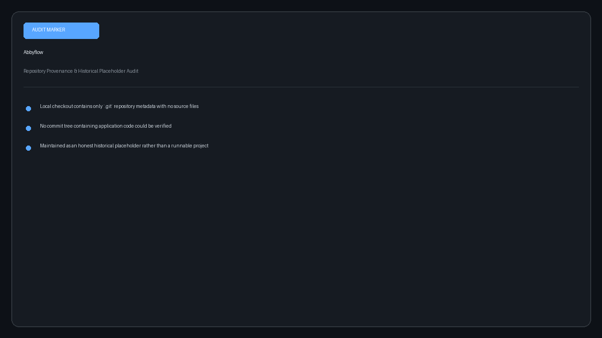

# Abbyflow · Historical Placeholder Audit

> **Repository provenance and historical checkout audit documentation.**

*Click the preview card above to watch the audit walkthrough.*

---

## Repository Status

A full audit of the local checkout for `abbyflow` confirmed that it contains only `.git` repository metadata with no tracked application source files or commit history.

To maintain 100% transparency across all 38 repositories, this project is cataloged candidly as an unrecovered historical placeholder.

## Media

- **Status Card:** `media/overview.png`
- **Audit Walkthrough:** `media/walkthrough.mp4`
